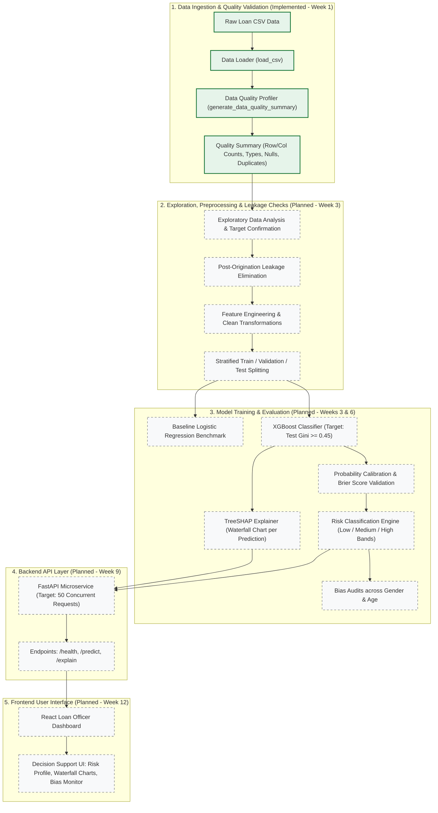

# FinWise Lending — System Architecture Design

## 1. Overview & Architectural Goals

The FinWise Lending Credit Risk Assessment System is an end-to-end machine learning platform designed to ingest loan application records, evaluate credit default risk, categorize applicants into transparent risk tiers, provide mathematically grounded explainability via SHAP waterfall charts, and serve decision-support insights to underwriters via an API and frontend dashboard.

### Core Architectural Objectives & Client Requirements:
1. **Separation of Concerns:** Distinct boundaries between data ingestion, model training, explainability, API serving, and user interface presentation.
2. **Defensive Ingestion:** Strict schema and data-quality validation preventing corrupted or unvalidated data from propagating into downstream pipelines.
3. **Discriminatory Power Target:** Model architecture oriented to achieve the client's target of **test-set Gini $\ge 0.45$** (equivalent to ROC-AUC $\ge 0.725$).
4. **Transparent Risk Categorization:** Classification of applicants into **Low**, **Medium**, and **High** risk bands for underwriter decision support.
5. **Instance-Level Explainability:** Generation of an individual **SHAP waterfall chart per prediction** to illustrate exact feature attributions driving each applicant's risk.
6. **High-Concurrency Serving:** FastAPI service designed and load-tested to handle **50 concurrent API requests** reliably.
7. **Algorithmic Fairness Audits:** Systematic evaluation of disparate impact and equal opportunity across **gender and age** cohorts.
8. **Jurisdiction-Agnostic Regulatory Compliance:** Regulatory and fair-lending requirements depend on the operating jurisdiction and require formal client and compliance team confirmation. Explainability frameworks (such as SHAP) provide mathematical feature attribution but do not on their own guarantee legal or regulatory compliance.

---

## 2. End-to-End System Architecture

The planned data and inference flow progresses from raw application ingestion to real-time risk evaluation in the loan officer dashboard.


### System Process Flow (Mermaid Source of Truth)



---

## 3. Implementation Status Matrix

To provide total transparency regarding progress, all system components are categorized below into **Implemented (Week 1)** and **Future Planned (Weeks 3–12)**:

| Component | Status | Target Milestone | Description / Deliverable |
| :--- | :---: | :---: | :--- |
| **CSV Ingestion Engine** | **Implemented** | Week 1 | `src.data_pipeline.load_csv`: Safe, validated file loading with defensive error handling (0-byte, directory, and parser checks). |
| **Data Quality Profiler** | **Implemented** | Week 1 | `src.data_pipeline.generate_data_quality_summary`: Automated reporting of shapes, null counts, column data types, and duplicate records. |
| **Pipeline Test Suite** | **Implemented** | Week 1 | `tests/test_data_pipeline.py`: 11 automated pytest tests verifying loading, validation, and zero-data-loss guarantees. |
| **EDA & Target Confirmation** | Planned | Week 3 | Data profiling across client datasets to inspect candidate target columns (`loan_status` vs `is_default`) and confirm ground-truth definitions. |
| **Data Leakage Elimination** | Planned | Week 3 | Systematic audit and exclusion of post-origination features (e.g., collections, post-approval payment statuses). |
| **Feature Engineering & Splits**| Planned | Week 3 | Underwriting ratio generation (DTI, utilization) and strictly isolated stratified train/validation/test splits. |
| **Baseline Model Benchmark** | Planned | Week 3 | Logistic Regression benchmark establishing baseline ranking performance on the holdout partition. |
| **XGBoost Classifier** | Planned | Week 3 | Regularized gradient boosted tree model targeting **test-set Gini $\ge 0.45$** (ROC-AUC $\ge 0.725$). |
| **Probability Calibration** | Planned | Week 6 | Calibration analysis (Platt scaling / Isotonic regression) and Brier score evaluation to produce true posterior default probabilities. |
| **Risk Band Classification** | Planned | Week 6 | Calibration of default probabilities into **Low**, **Medium**, and **High** risk bands (thresholds to be agreed with client underwriting policy). |
| **SHAP Explanation Engine** | Planned | Week 6 | TreeSHAP explainer generating a **SHAP waterfall chart per prediction** for instance-level underwriter decision support. |
| **Fairness & Bias Audits** | Planned | Week 6 | Disparate impact ratio and equal opportunity difference audits across **gender** and **age** subgroups. |
| **FastAPI Microservice** | Planned | Week 9 | High-concurrency asynchronous API architected to support **50 concurrent requests** with Pydantic validation. |
| **React Underwriter Dashboard**| Planned | Week 12 | Interactive web console providing single/batch evaluation, waterfall visualizations, and portfolio risk distributions. |

---

## 4. Component Responsibilities & Architectural Flow

### 4.1 Data Ingestion & Quality Validation Layer (Implemented - Week 1)
- **Defensive Ingestion:** Verifies file existence, verifies path is a file (not a directory), blocks 0-byte files, and handles CSV syntax errors.
- **Automated Profiling:** Extracts row count, column count, column names, pandas data types, null counts per feature, and total duplicate rows.
- **Data Preservation Guarantee:** Does not drop rows or columns silently and does not hardcode target definitions.

### 4.2 Data Exploration, Preprocessing & Leakage Checks (Planned - Week 3)
- **Exploratory Profiling:** Inspects empirical distributions and missingness mechanisms of client data.
- **Target Variable Confirmation:** Confirms target variable definition with client domain experts before modeling.
- **Data Leakage Audit:** Audits features to isolate and eliminate variables populated *after* loan origination.
- **Preprocessing Pipeline:** Applies missing value strategies (leveraging XGBoost native sparsity handling where appropriate) and categorical encoding with strict out-of-fold parameter calculation to prevent split contamination.

### 4.3 Model Training & Evaluation Layer (Planned - Weeks 3 & 6)
- **Baseline Model:** Logistic Regression model establishing reference Gini, ROC-AUC, and PR-AUC.
- **XGBoost Classifier:** Hyperparameter-tuned tree boosting algorithm configured with second-order regularization and early stopping, aiming for **test-set Gini $\ge 0.45$**.
- **Probability Calibration:** Assesses probability reliability via reliability diagrams and Brier score, applying calibration if uncalibrated margins distort risk probabilities.
- **Risk Classification:** Assigns applicants into **Low**, **Medium**, or **High** risk bands based on calibrated probability of default.
  > *Note on Thresholds:* Specific cutoffs dividing Low, Medium, and High risk are not hardcoded or assumed. They will be calibrated from the empirical default rate and approved by client underwriting leadership.
- **Fairness & Bias Auditing:** Evaluates Disparate Impact Ratio (DIR) and Equal Opportunity Difference (EOD) across available gender and age attributes.

### 4.4 Explainability Layer: TreeSHAP (Planned - Week 6)
- **Instance-Level Waterfall Charts:** For every evaluated applicant, the model computes exact Shapley attributions via TreeSHAP and produces a waterfall chart showing how individual financial attributes push risk higher or lower relative to base expectation.
- **Underwriter Decision Support:** Ranks the top positive and negative risk factors to assist underwriters in making informed lending decisions.
- **Governance & Legal Note:** SHAP provides mathematical feature attribution based on cooperative game theory. It does not on its own guarantee legal or regulatory compliance. Formal adverse action notice wording, governance processes, and fair lending obligations depend on the specific jurisdiction and must be vetted by client compliance teams.

### 4.5 Serving Layer: FastAPI (Planned - Week 9)
- **High-Concurrency Architecture:** Designed to handle **50 concurrent requests** simultaneously. Utilizes asynchronous endpoint routing (`async def`) and offloads CPU-bound tree inference to worker threadpools or optimized C-API runtimes to prevent event loop blocking.
- **Schema Validation:** Enforces strict Pydantic models for incoming applicant features, rejecting invalid data types or out-of-range numerical values with descriptive HTTP 422 errors.
- **Planned Endpoints:**
  - `GET /health`: Liveness and model readiness probe.
  - `POST /api/v1/predict`: Generates default probability and Low/Medium/High risk band classification.
  - `POST /api/v1/explain`: Computes instance SHAP values and returns waterfall chart attribution data.

### 4.6 Presentation Layer: React Dashboard (Planned - Week 12)
- **Underwriter Console:** Web application enabling loan officers to submit applicant data, inspect real-time risk assessments, view the corresponding SHAP waterfall chart, and document review notes.
- **Decision Support:** Serves strictly as a decision-support tool. It does not enforce automated approval or rejection, leaving loan determinations to authorized human underwriters in accordance with client credit policy.

---

## 5. Proposed API Boundaries & Schema Design (Planned - Week 9)

### Endpoint: `POST /api/v1/predict`
#### Request Payload
```json
{
  "applicant_id": "APP-98234",
  "annual_income": 75000.0,
  "loan_amount": 15000.0,
  "loan_term_months": 36,
  "employment_length_years": 4.5,
  "home_ownership": "MORTGAGE",
  "debt_to_income_ratio": 0.22,
  "revolving_utilization_pct": 34.5,
  "num_open_accounts": 8,
  "derogatory_records_count": 0
}
```

#### Response Payload
```json
{
  "applicant_id": "APP-98234",
  "probability_of_default": 0.038,
  "risk_band": "Low",
  "evaluation_timestamp": "2026-10-13T12:00:00Z",
  "model_version": "v1.0.0-xgb"
}
```

### Endpoint: `POST /api/v1/explain`
#### Response Payload (Data for Waterfall Chart)
```json
{
  "applicant_id": "APP-98234",
  "base_expected_value": 0.082,
  "prediction_margin": -0.044,
  "waterfall_attributions": [
    {
      "feature": "debt_to_income_ratio",
      "feature_value": 0.22,
      "shap_value": -0.024,
      "direction": "decreases_risk"
    },
    {
      "feature": "derogatory_records_count",
      "feature_value": 0,
      "shap_value": -0.019,
      "direction": "decreases_risk"
    },
    {
      "feature": "revolving_utilization_pct",
      "feature_value": 34.5,
      "shap_value": 0.007,
      "direction": "increases_risk"
    }
  ]
}
```

---

## 6. Concurrency, Defensive Engineering & Security

1. **50 Concurrent Requests Handling:**
   - FastAPI server configured with Uvicorn worker clustering.
   - Pre-warmed model instances in worker memory to eliminate cold-start latency.
   - Non-blocking I/O with performance benchmarks simulating 50 simultaneous client connections.
2. **Defensive Validation & Graceful Fallbacks:**
   - Ingestion and API layers reject corrupted, malformed, or out-of-domain records.
   - If inference or SHAP computation fails, the API responds with a structured error log and flags the record for manual underwriter review rather than failing silently.
3. **Data Privacy & Governance:**
   - PII is excluded from version control and isolated from feature matrices.
   - Only tokenized applicant IDs are tracked in inference telemetry.
   - Jurisdiction-specific regulatory and fair lending compliance will be validated in consultation with client legal and compliance representatives.

---

## 7. Testing & Quality Assurance Plan

| Tier | Scope | Target / Framework | Status |
| :--- | :--- | :--- | :---: |
| **Data Ingestion Unit Tests** | Path checks, 0-byte checks, corruption handling, quality summaries | 11 tests in `tests/test_data_pipeline.py` via `pytest` | **Passed (100%)** |
| **Feature & Leakage Tests** | Out-of-fold parameter isolation, post-origination leakage detection | `pytest` feature suite (Week 3) | Planned |
| **Model Discrimination Tests**| Verification of test-set Gini $\ge 0.45$ (ROC-AUC $\ge 0.725$) | `pytest` model validation suite (Week 3 & 6) | Planned |
| **Concurrency & Latency Tests**| Load testing with 50 concurrent requests | Locust / `pytest-asyncio` / `httpx` (Week 9) | Planned |
| **Fairness & Bias Audits** | Disparate impact and equal opportunity audits across age and gender | Custom bias auditing suite (Week 6) | Planned |
